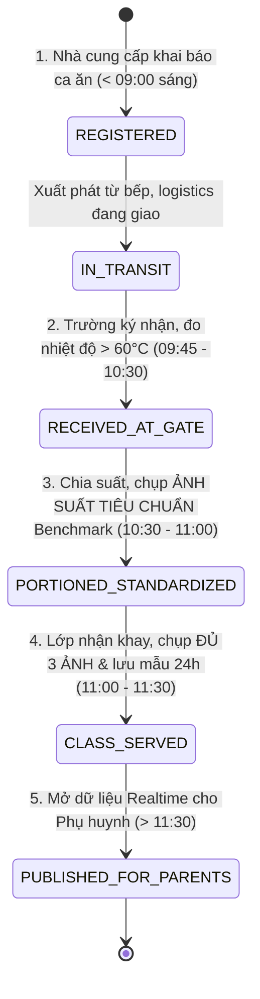

# TỔNG QUAN HỆ THỐNG GIÁM SÁT SUẤT ĂN BÁN TRÚ (MEALTRACE / SMARTMEAL)

## 1. Mục tiêu Dự án
Hệ thống **MealTrace** nhằm minh bạch hóa và giám sát toàn trình chuỗi cung ứng - vận chuyển - bàn giao - phân chia - sử dụng suất ăn bán trú học đường và suất ăn công nghiệp. 
Đảm bảo an toàn vệ sinh thực phẩm, đúng định lượng cam kết, lưu mẫu 24h theo chuẩn Bộ Y tế, và cung cấp kênh giám sát thời gian thực (Real-time) đáng tin cậy cho Phụ huynh và Ban giám hiệu.

---

## 2. Sơ đồ Chuyển Trạng thái Toàn trình (State Machine)
Vòng đời của một ca suất ăn trong ngày (`MealBatch`) vận hành nghiêm ngặt qua 6 trạng thái logic không thể đảo ngược:

### Danh mục 6 Trạng thái:
1. `REGISTERED`: Nhà cung cấp khai báo món, người nấu, xe, biển số, số lượng kế hoạch, xuất xứ nguyên liệu.
2. `IN_TRANSIT`: Xe vận chuyển xuất phát khỏi bếp trung tâm, đang trên đường đến trường.
3. `RECEIVED_AT_GATE`: Đại diện trường kiểm đếm thực nhận, đo nhiệt độ (> $60^\circ\text{C}$), ký biên bản điện tử (OTP/PIN).
4. `PORTIONED_STANDARDIZED`: Bếp trường/cán bộ dinh dưỡng phân chia suất ăn, chụp 1 Ảnh Suất Tiêu Chuẩn (Benchmark).
5. `CLASS_SERVED`: Giáo viên tại lớp nhận khay cơm, kích hoạt camera đóng Watermark bắt buộc chụp đủ 3 khay cơm ngẫu nhiên (chống trùng lặp hash), hoàn thành biên bản lưu mẫu 24h.
6. `PUBLISHED_FOR_PARENTS`: Hệ thống mở cổng dữ liệu cho phụ huynh đối chiếu ảnh chuẩn $\leftrightarrow$ ảnh thực tế, theo dõi giờ ăn và đánh giá chất lượng 1-5 sao.

---

## 3. Phân quyền Người dùng & Vai trò (RBAC)
Hệ thống thiết lập 8 vai trò chuyên trách theo trách nhiệm thực tế:
- **`ROLE_SUPPLIER` (Nhà cung cấp / Bếp trưởng)**: Khởi tạo ca ăn, khai báo thực đơn, định lượng, chứng từ thực phẩm, phương tiện logistics.
- **`ROLE_GATE_INSPECTOR` (Cán bộ kiểm duyệt / Thanh tra cổng)**: Tiếp nhận xe, đối chiếu biển số/tài xế, kiểm tra cảm quan, đo nhiệt độ > 60°C, nhập số suất thực nhận, ký OTP.
- **`ROLE_NUTRITIONIST` (Cán bộ dinh dưỡng / Phụ trách bếp trường)**: Giám sát chia khay, chụp ảnh suất ăn chuẩn (Benchmark Photo).
- **`ROLE_TEACHER` (Giáo viên chủ nhiệm phụ trách lớp)**: Nhận khay tại phòng học, chụp bắt buộc 3 ảnh khay cơm (Tri-Photo), xác nhận lưu mẫu 24h tại tủ lạnh trường.
- **`ROLE_WARD_OFFICER` (Cán bộ y tế / Cán bộ phường)**: Giám sát vệ sinh an toàn thực phẩm tuyến cơ sở, kiểm tra đột xuất và tra cứu dữ liệu lưu mẫu.
- **`ROLE_PRINCIPAL` (Hiệu trưởng / Ban giám hiệu)**: Giám sát toàn diện báo cáo học đường, chỉ số hao hụt, cảnh báo vi phạm của các đơn vị.
- **`ROLE_PARENT` (Phụ huynh học sinh)**: Xem bảng tin thời gian thực của lớp con mình, đối chiếu khay cơm chuẩn vs thực tế, chấm điểm 1-5 sao và gửi phản ánh.
- **`ROLE_ADMIN` (Quản trị viên hệ thống)**: Phê duyệt/từ chối tài khoản, khóa tài khoản vi phạm, phát cảnh báo, cấp tích xanh uy tín, điều phối toàn bộ Dashboard.

### 3.1. Quy trình Kiểm chuẩn & Phê duyệt Tài khoản (Two-Phase Verification)
1. **Đăng ký**: Người dùng cung cấp đầy đủ: Họ tên, Email, Số điện thoại, Đơn vị/Trường, Địa chỉ, Mật khẩu và Vai trò đăng ký.
2. **Kích hoạt Email**: Hệ thống phát sinh token ngẫu nhiên có hiệu lực 24h và gửi Gmail xác nhận. Người dùng nhấn liên kết để kích hoạt email (`email_verified = true`).
3. **Phê duyệt Admin**: Sau khi email đã kích hoạt, hồ sơ tự động chuyển vào hàng đợi `PENDING` trên Admin Dashboard. Admin thẩm định và bấm **Phê duyệt** (hoặc **Từ chối** kèm lý do).
4. **Tích xanh Xác thực (Verified Badge)**: Dành cho các đơn vị/cán bộ gửi yêu cầu chứng thực danh tính chính quy. Admin xem xét và cấp/thu hồi tích xanh.

### 3.2. Chế tài Xử lý & Cảnh báo Vi phạm
- **Gửi cảnh báo**: Admin có quyền phát cảnh báo trực tiếp đến tài khoản bất kỳ kèm lý do và số lần vi phạm (`warning_count`). Cảnh báo hiển thị ngay trên Navbar và gửi thư thông báo.
- **Khóa tài khoản (`locked = true`)**: Đình chỉ quyền truy cập ngay lập tức đối với tài khoản vi phạm nghiêm trọng quy chuẩn bán trú.

---

## 4. Công nghệ Nền tảng (Tech Stack)
- **Backend**: Spring Boot 3.4.5, Java 21 LTS, Spring Security 6 (OAuth2 + Stateless JWT 5 ngày/7 ngày Token Rotation), Spring Data JPA, Liquibase.
- **Database**: PostgreSQL 16+.
- **Frontend**: Next.js 16 (App Router), React 19, Tailwind CSS.
- **Storage**: MinIO / AWS S3 (Lưu trữ ảnh suất ăn tiêu chuẩn, ảnh lớp học và ảnh chứng từ thực phẩm).

---

## 5. Hướng dẫn Điều phối & Đọc Tài liệu (Token-saving Navigation)
Khi phát triển hệ thống, **tuyệt đối không đọc lại toàn bộ tài liệu** để tiết kiệm context window và token:
1. Đọc tiến độ tại [PHASE_1_CORE.md](file:///D:/antigravity/software/docs/PHASE_1_CORE.md).
2. Khi code tính năng nào, chỉ mở đúng file tương ứng trong thư mục `docs/features/`:
   - `docs/features/feat_01_supplier_batch.md`
   - `docs/features/feat_02_gate_handover.md`
   - `docs/features/feat_03_portion_standard.md`
   - `docs/features/feat_04_classroom_serving.md`
   - `docs/features/feat_05_parent_feed.md`
3. Khi cần xem cấu trúc cơ sở dữ liệu: Xem [schema.sql](file:///D:/antigravity/software/docs/schema.sql).
4. Sau khi hoàn thành feature nào, đánh dấu tick `[x]` vào [PHASE_1_CORE.md](file:///D:/antigravity/software/docs/PHASE_1_CORE.md) và file feature tương ứng.
