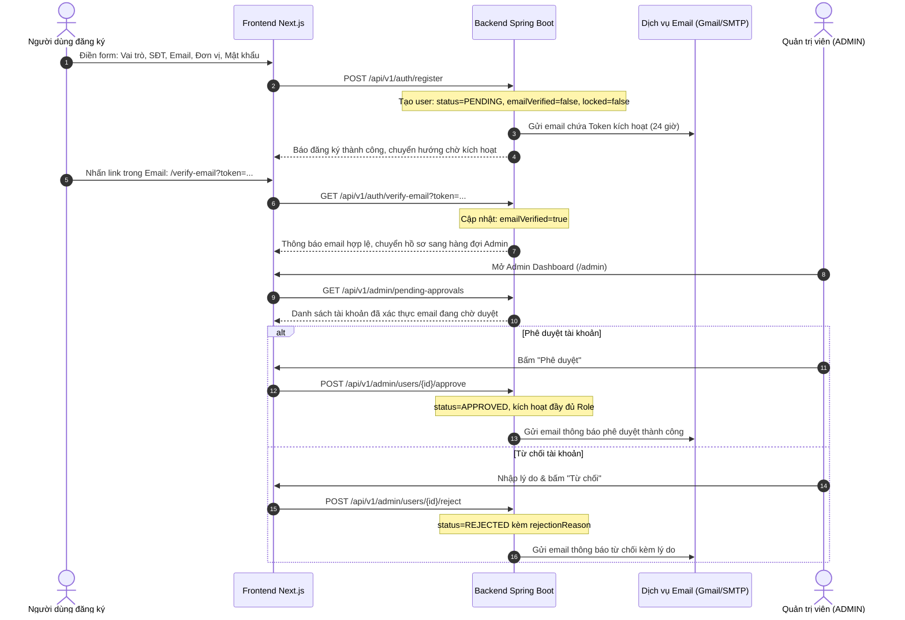

# FEAT-00: Quản Trị Tài Khoản, Phê Duyệt Đa Vai Trò & Xác Thực Email (Account Governance & Verification)

- **Trạng thái:** `[x] Hoàn thành`
- **Tác nhân tham gia:** Người dùng đăng ký (Nhà cung cấp, Giáo viên, Kiểm duyệt, Phường, Hiệu trưởng, Phụ huynh), Quản trị viên (`ADMIN`), Dịch vụ Email (SMTP / Simulation).
- **Mục tiêu:** Kiểm chuẩn danh tính đầu vào, phân quyền chính xác theo trách nhiệm pháp lý bán trú học đường, ngăn chặn tài khoản giả mạo, và cung cấp công cụ điều hành Dashboard toàn diện cho Admin.

---

## 1. Danh Mục Vai Trò Đăng Ký (Role Definitions)

| Mã Vai Trò | Tên Hiển Thị | Trách Nhiệm Nghiệp Vụ Bán Trú |
| :--- | :--- | :--- |
| `ROLE_SUPPLIER` | **Nhà cung cấp** | Bếp trung tâm, xuất ăn, xe logistics, giấy tờ nguồn gốc thực phẩm |
| `ROLE_TEACHER` | **Giáo viên** | Tiếp nhận tại phòng học, chụp ảnh 3 khay cơm, xác nhận lưu mẫu 24h |
| `ROLE_GATE_INSPECTOR` | **Cán bộ kiểm duyệt** | Kiểm tra cổng trường, đo nhiệt độ > 60°C, kiểm đếm thực nhận, ký OTP |
| `ROLE_WARD_OFFICER` | **Cán bộ phường** | Giám sát y tế, kiểm tra vệ sinh an toàn thực phẩm tuyến cơ sở |
| `ROLE_PRINCIPAL` | **Hiệu trưởng** | Đại diện Ban giám hiệu, giám sát toàn diện báo cáo & điều hành |
| `ROLE_PARENT` | **Phụ huynh** | Xem bảng tin realtime lớp con, đối chiếu ảnh chuẩn và đánh giá sao |
| `ROLE_ADMIN` | **Quản trị viên** | Quản trị tài khoản, phê duyệt, cấp tích xanh, phát cảnh báo vi phạm |

---

## 2. Quy Trình Phê Duyệt 2 Bước (Two-Phase Approval Workflow)

---

## 3. Các Đặc Quyền & Nghiệp Vụ Của Admin

1. **Khóa / Mở khóa tài khoản (`lock` / `unlock`):**
   - Đình chỉ ngay lập tức quyền truy cập của bất kỳ tài khoản nào khi có vi phạm.
   - Tài khoản bị khóa không thể đăng nhập (`locked = true`).
2. **Phát Cảnh Báo Vi Phạm (`warn`):**
   - Admin gửi thông điệp cảnh báo kèm tiêu đề và nội dung chi tiết.
   - Hệ thống tăng bộ đếm `warningCount`, hiển thị Warning Banner nổi bật trên Navbar của người dùng vi phạm và gửi email cảnh báo.
   - Lưu trữ toàn bộ lịch sử vi phạm trong bảng `account_warnings`.
3. **Quản Lý Tích Xanh Xác Thực (`verifiedBadge`):**
   - Người dùng đủ uy tín (nhà cung cấp đạt chuẩn, giáo viên chính thức) gửi yêu cầu cấp tích xanh.
   - Admin xem xét lý do và duyệt cấp hoặc thu hồi tích xanh.
   - Tài khoản có tích xanh hiển thị huy hiệu xanh Verified bên cạnh tên trên toàn bộ hệ thống.
4. **Admin Dashboard Tổng Quan:**
   - Thống kê 5 chỉ số động (Tổng user, Chờ duyệt, Tích xanh, Bị khóa, Đang hoạt động).
   - Bộ lọc đa tiêu chí (Search từ khóa, Lọc vai trò, Lọc trạng thái duyệt, Lọc tình trạng khóa).
